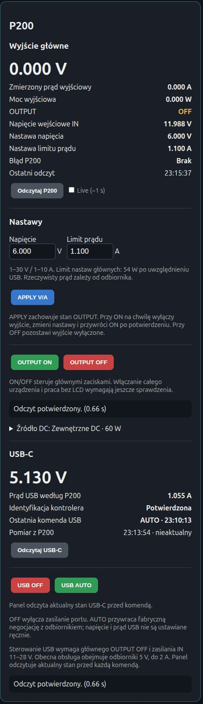

# ToolkitRC P200: verified browser-control prototype

[Polski](toolkitrc-p200.pl.md) · [CopperTrace project page](https://coppertrace.co.uk/projects/toolkitrc-p200/)

Public record updated **14 October 2026**. Detailed integration tests completed **10 October 2026**.

## Achievement

A modified **ToolkitRC P200 V1 / V1.05-STN**, with an observed GD32F103CBT6 MCU, is controlled from **Labrax Bench Control** through one USB-connected Pico bridge. The verified setup supports:

- Main voltage and current-limit setpoints.
- Desired-state main OUTPUT ON/OFF, rather than a toggle.
- APPLY that preserves the previous output state.
- Main voltage, signed current and power measurements.
- Optional Live polling at approximately one-second intervals.
- USB-C controller identification and voltage/current measurements.
- USB OFF and return to factory AUTO negotiation.
- An independent 12 V / 5 A input source; RIDEN is a separate bench channel.

## Architecture

```text
Browser → local Labrax service → USB Pico bridge
                                  ↓
                         custom clock/data GPIO link
                                  ↓
                         P200 firmware extension
                                  ↓
                         factory output action bodies
```

The implementation reuses the existing clock/data connection for the custom runtime link. The additional Pico used for early bus investigation is not required for normal control: use **one Pico per modified P200**. The P200 USB mass-storage interface is used for firmware updates, not ordinary runtime control. The MCU debug interface is disabled at application startup to free the reused pins.

The main SET commands update RAM while the output is OFF. ON follows the recovered factory action body and can save settings through the factory flash code. Factory regulator feedback, protection code and calibration were retained. The USB commands call the recovered factory USB OFF/AUTO functions; they do not write PD voltage/current configuration.

## APPLY sequence

APPLY obtains a fresh state under a single hardware session, checks input/fault status and the source budget, and remembers whether the main output was ON. If a change is needed while ON, it:

1. Sends OFF and verifies the output state.
2. Writes the voltage/current settings in an order that avoids an invalid intermediate power request.
3. Verifies both setpoints by independent state readback.
4. Rechecks the available power budget.
5. Restores ON only if the output was initially ON and every check succeeded.

An initially OFF output remains OFF. Unchanged settings do not cause an unnecessary power cycle. Failed OFF, SET or readback steps do not cause an automatic ON retry. **APPLY briefly interrupts output power**; continuous adjustment under load is not implemented.

Live is optional. Commands perform their own current-state checks, so an old panel snapshot or disabled Live does not itself prevent APPLY or OFF. The panel distinguishes measured output current from the configured current limit.

## Source and command limits

The extension accepts main setpoints **1–30 V / 1–10 A**, bounded by **200 W**. This is the accepted command range, not evidence that all values or maximum current have been load-tested.

For the current **12 V / 5 A / 60 W** source, the host uses a conservative **54 W shared budget**. Measured USB power is reserved from that budget before allowing a main-output setpoint. The updated custom main and USB commands accept measured input **11–28 V**, while retaining the existing input threshold, fault and factory protection checks.

The current custom USB test profile requires **main OUTPUT OFF** and covers **5 V receivers up to 2 A**. AUTO restores factory negotiation with the receiver. Manual PD voltage/current selection is not implemented; the load still determines actual current demand.

## Bench validation

| Check | Observed result |
| --- | --- |
| Main ON at 5 V / 1 A settings | Multimeter confirmed 5 V; controls remained responsive. |
| APPLY while ON, 5 → 6 V / 1 A | Output returned ON; P200 readback 6.034 V, no fault. |
| Main OFF | Independent status confirmed OFF. |
| USB OFF | TC64 went dark; independent status showed 0 V / 0 A. |
| USB AUTO | TC64 restored and reported 5.1 V / 1.4 A. |
| Working second unit | User reported a 30-minute stable run with responsive knobs. |

The current-limit setting was transmitted and read back. These no-load main tests **do not establish current-limit accuracy under load**. The small signed current offset measured while OFF was approximately −3 mA; it is a zero-offset observation, not load current.

Automated validation for this integration passed **40 adapter tests, six API tests, 18 frontend cases and ten ARM firmware tests**. The ARM tests cover the changed guard constants and retained command paths. Full direct USB readback after each update page matched the reviewed expected image; the 12 V guard update changed six bytes across three 1 KiB pages.



The screenshot is a saved 10 October snapshot: main OUTPUT OFF and USB AUTO. It is not a live instrument reading.

## Lessons and remaining work

Early debug-memory operations reset or froze the running supply, so the working runtime path uses the custom GPIO link rather than live SWD memory control. Firmware mapping was established through direct readback and observable boot markers before control commands were added.

The first P200 had intermittent shutdowns, also during idle tests, and was set aside. The second unit worked in the reported stability and command tests. This suggests a unit-specific issue, but the first unit's root cause has not been established.

Full device POWER control and operation with the LCD removed are not supported by the validated implementation. The current link stops responding after full power-off; main OUTPUT OFF is not whole-device shutdown. Adding another P200 is a separate per-unit backup, compatibility and integration task. The wider plan is a shared 24 V source feeding RIDEN and two P200 channels, each P200 with its own Pico and a shared-source power budget.

## Publication scope

This repository publishes the engineering record, site source and panel screenshot. It does not distribute vendor firmware dumps, device-specific calibration, unit identifiers or credentials. The work is a bench prototype, not a universal flash image or a claim of validation across every P200 revision. The original experiments did not include a bootloader backup, and recovery through USB was not guaranteed.
